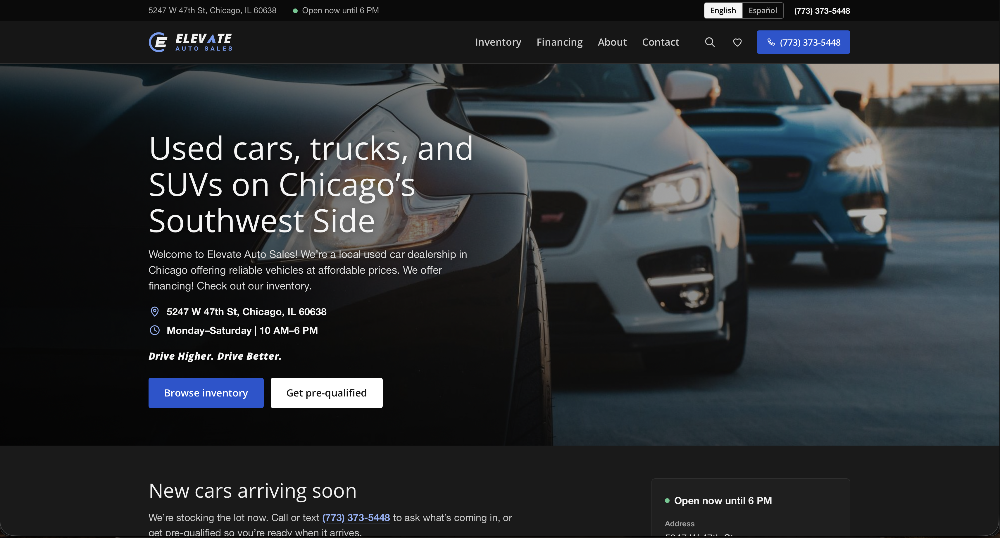
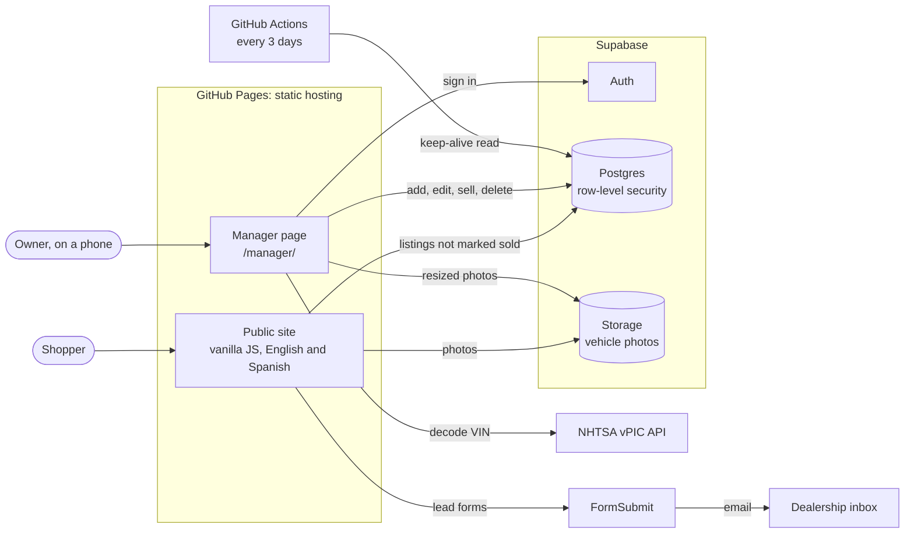

# Elevate Auto Sales

A bilingual website and phone-first inventory manager for an independent used-car dealership in Chicago.

**[Live site](https://YOUR-USERNAME.github.io/YOUR-REPO/)** · [Architecture](#architecture) · [Engineering highlights](#engineering-highlights) · [Running locally](#running-locally)

<p align="center">
  
  &nbsp;
  
</p>

## Overview

Elevate Auto Sales is a newly licensed independent dealership that decided to run without a dealer management system (DMS), the software many lots use to track inventory and publish it to their website. The owner needed three things: a site where shoppers can browse cars in English or Spanish, an easy path from browsing to a phone call or a financing request, and a way to list cars himself from his phone without learning new software.

This repository is that site. The public pages are plain HTML, CSS, and JavaScript hosted on GitHub Pages. Inventory, photos, and the owner's login live in Supabase, and the owner manages listings from a mobile admin page at `/manager/`. There's no server to maintain and nothing to rebuild when a car is added, and hosting, the database, and lead emails all run on free tiers.

## Features

**For shoppers**

- Inventory with filters and sorting, plus a header search that matches words in any order and ignores punctuation and accents ("f150", "crv", "honda 2017"). On desktop, `/` opens it and the arrow keys move through results.
- Vehicle pages with a photo gallery, specs, and features, and quick requests for availability, a test drive, or financing.
- A monthly payment calculator and a saved-vehicles list.
- Financing pre-qualification, test drive, vehicle question, and contact forms, delivered to the dealership's inbox.
- Full English and Spanish versions, picked from the browser's language and remembered between visits.
- Light and dark themes, and a phone layout with a bottom bar for call, text, and directions.

**For the owner, at `/manager/`**

- Email and password sign-in, with password reset by email.
- Add a car by typing its VIN: year, make, model, trim, body style, drivetrain, transmission, engine, and fuel type fill in from NHTSA's VIN decoder.
- Add photos from the camera or photo library, choose the main photo, and remove any.
- Mark a car sold to take it off the site (it moves to a Sold tab and can go back on sale), or delete it and its photos for good.
- Changes show up on the site right away, with no rebuild or redeploy.

## Architecture



Both pages run in the browser and talk to Supabase directly. The public site reads listings from Supabase's REST API with `fetch` and the project's publishable key, which is designed to be public; what any visitor can read or write is decided by Postgres row-level security, not by the front end. The manager page uses `supabase-js` for sign-in, writes, and photo uploads. Lead forms go to FormSubmit, which emails each submission to the dealership, so the project has no server of its own.

## Tech stack

| Area | Choice | Why |
| --- | --- | --- |
| Front end | HTML, CSS, vanilla JavaScript | No framework or build step, and no JavaScript dependencies on the public site |
| Hosting | GitHub Pages | Free, and deploys on every push |
| Data, auth, photos | Supabase: Postgres, Auth, Storage | Free tier, with row-level security enforcing permissions |
| VIN decoding | NHTSA vPIC API | Free public data from the U.S. Department of Transportation |
| Lead delivery | FormSubmit | Form-to-email with no backend |
| Automation | GitHub Actions | Scheduled job that keeps the free database from pausing |
| Tooling | Python (`build.py`) | Bundles the site into one HTML file for preview links |

## Engineering highlights

### No framework, on purpose

A small dealership's site doesn't need a framework, and a client without a developer on staff shouldn't inherit dependencies that need patching. The public site is plain files that any static host can serve, with no JavaScript dependencies and no build step. `js/app.js` renders each page from template literals behind a hash router (`#inventory`, `#v-<stock number>`, `#financing`, and so on). `build.py` only bundles everything into one self-contained HTML file, which made it easy to send the owner preview links during design rounds. The trade-off is search visibility: vehicle pages are hash routes rather than separate URLs, so pre-rendering a page per vehicle is first on the roadmap.

### One file owns the data source

`js/inventory-source.js` is the only code that knows where vehicles come from. `load()` fetches records, and `normalize()` maps them into the single vehicle shape the rest of the site renders, whether they come from a JSON file, a DMS-style export (it accepts a `photos` array or pipe-separated `PhotoURLs`), or Supabase's snake_case rows. The site was first planned around a DealerCenter inventory feed. When the owner decided to list cars himself instead, the public site's move to Supabase came down to this file and two settings in `js/config.js`.

### Permissions live in the database

The publishable key in `js/config.js` ships to every browser, so nothing in the front end is trusted. `supabase/setup.sql` turns on row-level security: anyone can read vehicles that aren't sold (admins see all of them), while inserts, updates, and deletes require the signed-in user to be in an `admins` table, checked by a `security definer` function, `is_admin()`. That table has row-level security on, no policies, and all grants revoked, so the API can't read or change it, and a login that isn't on it can't change anything. Storage policies apply the same rule to photos, the bucket accepts only JPEG, PNG, and WebP files up to 5 MB, and check constraints (VIN length, year range, price and mileage bounds, stock-number format) reject bad data even if someone goes around the UI.

### Photos are resized on the phone

Phone photos are far larger than a web page needs. Before uploading, the manager page draws each photo onto a canvas and encodes two JPEGs: 1600 px on the long side for the vehicle page, and 640 px for cards and gallery thumbnails. Pages stay fast on mobile data, and the free tier's 1 GB of storage holds roughly 2,000 photos. Files are uploaded with a one-year cache header. If a save fails, the files uploaded during that attempt are deleted, and photos the owner removes are only deleted from storage after the save succeeds, which keeps the bucket and the database consistent.

### Data entry built around the VIN

When the VIN field reaches 17 characters, the manager page looks it up in NHTSA's vPIC decoder and maps the response onto the site's own options: body class becomes a body style, drive type becomes FWD, AWD, 4WD, or RWD, and displacement, cylinders, and turbo become an engine label like "1.5L I4 Turbo". The field uppercases as you type, warns about I, O, and Q (letters VINs never use), and fills in a unique stock number from the last six characters. Price and mileage format themselves, missing fields are flagged and focused, database errors (a duplicate stock number, a permission denial, a dropped connection) turn into plain-English messages, and leaving with unsaved changes asks first.

### Fails soft, and stays up on free tiers

The inventory request times out after 12 seconds. If Supabase can't be reached, the inventory sections show the phone number and a pre-qualification button while the rest of the site keeps working, and an empty lot shows "New cars arriving soon" instead of a blank grid. Forms keep the visitor's answers and show the phone number if sending fails. Supabase pauses free projects after about a week with little activity, which would take the inventory offline, so a scheduled GitHub Actions workflow reads one row every three days. It uses the same public config file as the site, so there are no secrets to manage.

### Leads without a backend or sensitive data

Forms post to FormSubmit's AJAX endpoint, which emails the dealership a table of answers along with the page, language, and time sent. A hidden honeypot field filters out bots, and the site won't send from `localhost`, a file opened from disk, or the preview build, so testing can't email the dealership by accident. The financing form is deliberately a pre-qualification: it never asks for a Social Security number or birth date, which shouldn't travel by email.

### Bilingual throughout

Every string on the public site, including vehicle features, badges, business hours, and form labels, comes from `js/i18n.js` in English and Spanish. Search understands Spanish words like "camioneta" and "troca", and each lead is tagged with the language it was sent in. Emails arrive in English for the dealership, with "(en español)" added to the subject.

## Project structure

```
.
├── index.html                          Public site
├── css/styles.css                      Design tokens, layout, light and dark themes
├── js/
│   ├── config.js                       Business details, Supabase URL and key, lead endpoint
│   ├── inventory-source.js             The only code that knows where vehicles come from
│   ├── app.js                          Router, pages, search, filters, forms, payment calculator
│   ├── i18n.js                         English and Spanish text
│   └── brand.js                        Logo and photo placeholders
├── manager/                            Owner's admin page
│   ├── index.html
│   ├── manager.js                      Sign-in, VIN decoding, photo processing, listing changes
│   └── manager.css
├── supabase/setup.sql                  Tables, constraints, row-level security, photo storage
├── data/inventory.json                 Fallback listings when no database is configured
├── assets/                             Favicon and images
├── docs/SETUP.md                       Setup and maintenance guide
├── .github/workflows/keep-alive.yml    Keeps the free database from pausing
└── build.py                            Bundles the site into one self-contained HTML file
```

## Running locally

Clone the repository, then serve it from the project folder:

```bash
python3 -m http.server 8000
```

Open http://localhost:8000. A few notes:

- Use a local server rather than opening `index.html` directly, because browsers block the inventory request on `file://` pages. `python3 build.py` writes a self-contained copy to `dist/` that does work with a double-click.
- Forms don't send from `localhost` unless you add `?send=1` to the address.
- With `supabaseUrl` and `supabaseKey` left empty in `js/config.js`, the site reads `data/inventory.json` instead of the database.
- Connecting a Supabase project for the manager page takes about 15 minutes. The steps are in [`docs/SETUP.md`](docs/SETUP.md), along with form email setup and the launch checklist.

## How the project ran

The project ran like a small client engagement. It began with discovery questions for the owner and a close look at another dealer's site he liked, a DealerCenter template whose credit application collected Social Security numbers and birth dates, which this build deliberately avoids. A written proposal followed, with 24 functional and non-functional requirements, a scope split between v1 and a later phase, a timeline, costs, risks, and system design diagrams: use case, sequence, and activity diagrams, an entity-relationship model, and a sitemap. DealerCenter and other DMS products were weighed against a custom build, and the plan settled on a custom site that could read a DMS feed later, which is why the data layer is isolated.

Prototypes went to the owner as single-file preview links. After his feedback, a heavily illustrated first design was replaced with a plain, information-first layout closer to the site he'd pointed to, and later rounds added Spanish, search, and live lead emails. When he decided against a DMS, the manager page and Supabase backend were added, and the public site changed data sources without a rewrite.

## Roadmap

- Move to the dealership's own domain.
- Pre-render a page per vehicle (for example with Astro) so each listing can show up in search results; today's hash-routed vehicle pages share one URL.
- Embed a Google map and reviews once the Google Business Profile is live.
- Move Supabase to the paid plan for daily backups once the business depends on the site.

## Credits and license

Built by Cesar Batrez-Delatorre for Elevate Auto Sales. Placeholder hero photo by Erik Mclean on Unsplash.

No open-source license is offered. The code is public for review, and the Elevate Auto Sales name, logo, and site content belong to the dealership.
